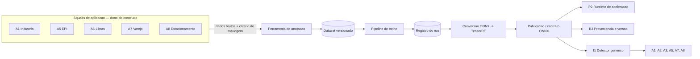
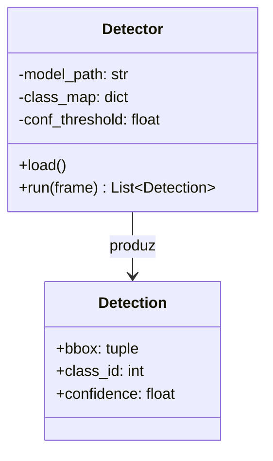

# Arquitetura — MOD-1 (Fábrica e Detecção)

ODS 2026/2 · Squad Biblioteca · Componentes: B5 (Fábrica de artefatos) e I1 (Detecção por quadro)

## 1. Contexto

MOD-1 não é dono do conteúdo dos dados, é dono do **processo** que transforma dado bruto de qualquer squad de aplicação em artefato versionado, pronto para rodar na Jetson. As aplicações (A1, A3, A4, A5, A6, A7, A8) decidem o quê coletar e o critério de rotulagem; MOD-1 entrega a ferramenta, executa o treino, converte e publica.

Diagrama completo em `diagrams/contexto.mermaid`.

## 2. Fluxo do pipeline (B5)

1. **Anotação** — squad de aplicação entrega dados brutos + guia de rotulagem (classes, critério de ambiguidade); MOD-1 mantém a ferramenta (CVAT ou Label Studio) e roda a anotação.
2. **Dataset versionado** — cada versão de dataset vira uma pasta com `manifest.json` (origem, critério usado, contagem por classe, hash).
3. **Treino e avaliação** — script genérico parametrizado por arquitetura/dataset/hiperparâmetros; métricas e configuração ficam em `run.json`.
4. **Registro** — toda execução de treino recebe um identificador de versão, propagado depois em todo evento (exigência de B3).
5. **Conversão** — PyTorch → ONNX → TensorRT, com escolha de precisão (FP16/INT8) e medição do custo de acurácia.
6. **Publicação** — artefato entregue no formato que P2 consome, com latência medida na placa.

Sequência detalhada de interação com B3, B4 e P2 em `diagrams/pipeline.mermaid`.

## 3. Componente I1 — Detector genérico

Uma única implementação de detector, parametrizada por artefato e mapa de classes, não um detector por aplicação.

Contrato de saída (caixa, classe, confiança) é o primeiro esquema a fechar com B1, pois quase toda a camada 3 consome essa estrutura.

## 4. Decisões arquiteturais

| Decisão | Escolha | Motivo |
|---|---|---|
| Ferramenta de anotação | CVAT ou Label Studio (containerizada) | Madura, evita reconstruir UI de rotulagem do zero |
| Versionamento de dataset | Pasta + `manifest.json` | Simples de auditar, sem dependência extra |
| Framework de treino | Ultralytics/YOLO para detecção; wrappers pontuais para outros tipos de modelo | Reaproveita competência existente na turma |
| Contrato de inferência | Classe `Detector` única, artefato + `class_map` como parâmetro | Evita reescrever I1 por aplicação |
| Conversão | Script único parametrizado por precisão (FP16/INT8) | Centraliza o custo de acurácia medido |

## 5. Riscos

- **Orçamento de memória da Jetson (8 GB)** — vários modelos residentes ao mesmo tempo podem não caber; decisão de carregamento sob demanda depende de alinhamento com P2.
- **Atraso na entrega dos guias de rotulagem pelas aplicações** — bloqueia a esteira de anotação; mitigar com prazo definido na primeira reunião de squad.
- **Objetos pequenos/rápidos (ex. bola em A4)** — caso difícil dentro de I1, não deve ser tratado como "só mais uma classe".
